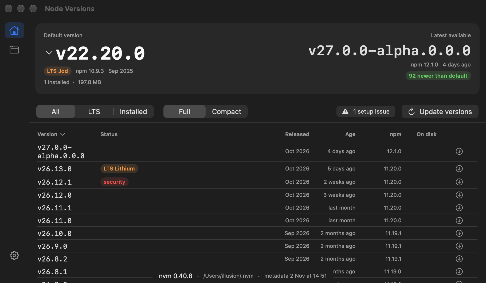
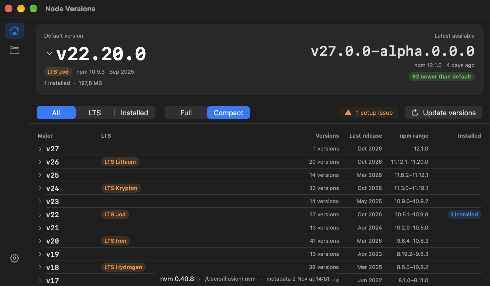
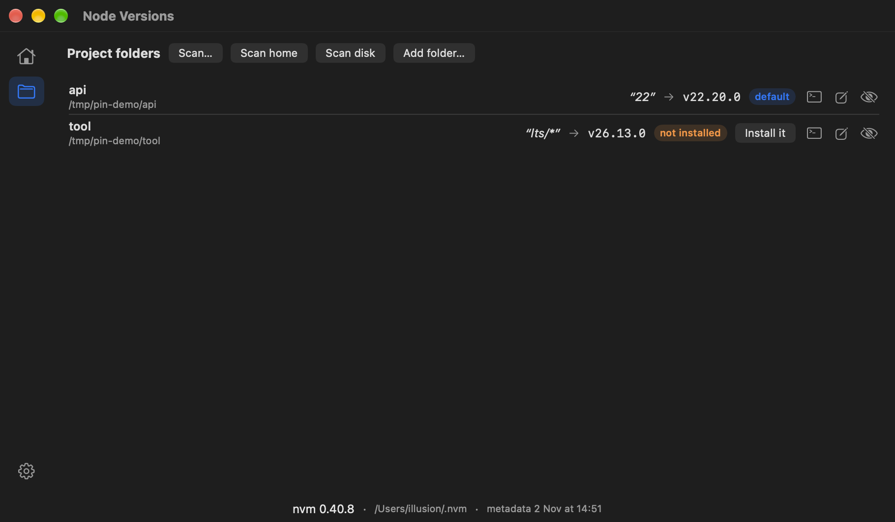

# nvm-app


Native Swift (SwiftUI, SwiftPM) GUI for [nvm-sh](https://github.com/nvm-sh/nvm) on macOS:
browse the version catalog with release dates / npm / LTS codenames, install with package
migration, set the new-shell default, watch `.nvmrc` project folders, open Terminals on a
chosen version, install the zsh auto-use hook, and get setup health checks.

Capability reference and design rationale: [`docs/nvm-capabilities.md`](docs/nvm-capabilities.md).

## Screenshots

| Home — Full table | Home — Compact majors | Project folders |
|---|---|---|
|  |  |  |

Full mode lists every patch release with release date, age, bundled npm, on-disk size and
globals. Compact mode folds majors (version count, last release, npm range, installed count)
and expands majors → minors → patches on click. The folders page watches `.nvmrc` pins:
scan home/disk/any folder, edit or remove pins, open a Terminal in the folder on its pinned
version, hide-not-remove a watch.

## Install

Grab `nvm-app-<version>.dmg` from the [latest release](../../releases/latest), open it,
drag **nvm-app** to **Applications**. The build is unsigned — first launch: right-click →
Open → Open. Requires an nvm-sh install (`~/.nvm/nvm.sh`).

## Build from source

Requires Swift 6 / Xcode 26 (macOS 26 deployment target).

```sh
swift build          # NVMCore library + NVMApp executable
swift test           # core suites
swift run NVMApp     # opens the window

sh Tools/make-app-bundle.sh   # build/NVMApp.app (Dock-ready)
sh Tools/make-dmg.sh          # build/nvm-app-<version>.dmg
```

The app needs an nvm-sh install (Homebrew copies are flagged by the Health checks). Override
the directory with `defaults write com.illusion.nvm-app nvmDirOverride -string 'path/to/nvm'`
(or set `XDG_CONFIG_HOME`).

## How it talks to nvm

`nvm` is a shell **function**, not a binary (`which nvm` fails). Every command runs as:

```
zsh -c 'export NVM_DIR="…"; . "$NVM_DIR/nvm.sh" --no-use; nvm <args>'
```

`--no-use` keeps read-only queries from switching anything; `TERM=dumb` + `--no-colors`
keep output parseable. Read-only state (installed versions, alias files, install locks) is
read directly off disk in `NVMLayout`.

**A GUI cannot switch versions inside your existing terminals** — `nvm use` edits one
shell's PATH. The real levers this app provides:

- **Set default** → `nvm alias default <v>` (applies to every new shell)
- **Install** → `nvm install` with `--offline` / `--reinstall-packages-from=` options
- **Per project** → write a `.nvmrc`, watch folders, scan for pins
- **New shell** → terminal icon opens Terminal (tab if open) with the version active;
  folder rows `cd` there first — or install the zsh `chpwd` auto-use hook in Settings
- **Existing shell** → `nvm use <v>` yourself; the app cannot reach live shells

## Layout

- `Sources/NVMCore` — `NVMLayout` (disk state + installed extras: globals, size, install date),
  `NVMShellRunner` (zsh bridge), `RemoteCatalogParser` (`ls-remote` parsing),
  `DistMetadata` (nodejs.org `index.json` fetch + gzip inflate + on-disk cache),
  `Nvmrc` + `NvmrcScanner` (pins + bounded tree scan), `AutoUseHook` (marker-delimited
  zsh `chpwd` block in `~/.zshrc`), `TerminalLauncher` (Terminal.app automation),
  `HealthChecker` (npm prefix / ownership / Homebrew-nvm checks),
  `NodeVersion`, `NVMModel` (observable state)
- `Sources/NVMApp` — SwiftUI: Home (banner + filters + Full/Compact table), install sheet, setup view
- `Tests/NVMCoreTests` — swift-testing suites for parsing, tree grouping, dist decoding + cache

Catalog metadata is cached at `~/Library/Application Support/nvm-app/dist-index.json`:
launch renders from cache instantly, refreshes in background when older than 24 h,
and the table still works offline with cached data. Download requests gzip
(~600 KB vs ~5 MB raw) and inflates via zlib.

## Roadmap

1. ~~`.nvmrc` awareness~~ — done: PinCard under the banner (choose folder, see the
   pin → `nvm version` / `version-remote` resolution, install/set-default, edit
   or remove the file; right-click any table row to pin it)
2. ~~Shell integration helper~~ — done: Settings installs the zsh `chpwd` auto-use hook
   as a marker-delimited `~/.zshrc` block (one-time backup, foreign-hook detection,
   optional auto-install-missing toggle)
3. ~~"Run in Terminal with this version"~~ — done: terminal icon on installed rows and
   pinned folder rows; new tab if Terminal is open, new window otherwise
4. ~~Health checks~~ — done: `~/.npmrc prefix=` conflict, `~/.nvm` ownership walk,
   Homebrew-nvm detection (Settings → Health + Home issue badge)
5. ~~Apple Silicon guard~~ — done: "rosetta" badge on pre-v16 rows, install
   confirmation dialog, warning inside the install sheet (`hw.optional.arm64` sysctl)
